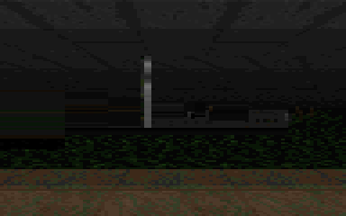

# Doom on Qwen

<p align="center">
  
</p>

Doom, running on a RV32IM CPU compiled into the weights of Qwen3.5-4B.

The CPU is a 55-layer transformer circuit emitted into the base model, with every weight computed
by a compiler rather than trained. Its memory is Qwen's own Gated DeltaNet state, which the delta
rule rewrites one row at a time, so the registers, stack and program counter all live in the model.
A guest instruction costs about 1.6 predicted tokens, and the guest never runs as a process of its
own.

The port targets the LX machine of
[linuxformer](https://github.com/itsrealranky/linuxformer), with DoomGeneric as the engine.
`lx.core.build` emits the machine into the model's layers. The emit technique comes from
[Qwenputer](https://github.com/divagr18/qwenputer); this repo contains none of its code and loads
none of its checkpoint.

| clip | frames | verified | GPU |
|---|---|---|---|
| **192x120** | 116 | 116/116 byte-exact | A100 40GB, 19,109 tok/s |
| [96x60](doom-lx/ops/work/preview/doom-e1m5-in-weights-96x60.webp) | 116 | 116/116 byte-exact | L40S, 17,700 tok/s |

Both clips are the first 11.6 seconds of E1M5, at two render sizes. A frame is only written once
every token that produced it has verified, and it has to match `fastemu-lf`, a native C emulator
given the same ELF and key schedule, byte for byte. All 116 frames of both clips do. The pixels
come from the reference machine's framebuffer; the circuit's part is predicting the instruction
stream that draws them.

## Check the frames

[`doom-lx/oracle/`](doom-lx/oracle) has the md5 of every reference frame of the 192x120 build
(PPM pixel payload, header excluded) and a checker:

```bash
python doom-lx/oracle/check_frames.py <frames-dir>      # frame-0006.ppm .. frame-0121.ppm
```

It prints `116/116 frames match` and exits 0 only if every frame is present and identical.
[`doom-lx/oracle/README.md`](doom-lx/oracle/README.md) shows how to regenerate the reference frames
with `fastemu-lf` in under a second, without a GPU.

## Run it

The linuxformer commit is pinned in [`doom-lx/LINUXFORMER_COMMIT`](doom-lx/LINUXFORMER_COMMIT).
`make_lxsrc.sh` clones it, refuses any other commit, and assembles the source directory the
scripts expect.

```bash
git clone --recursive https://github.com/ash-eriga/Doom-On-Qwen
cd Doom-On-Qwen
doom-lx/ops/work/make_lxsrc.sh lxsrc
```

Emit the circuit for your build on CPU first, which takes about 11 minutes. It is per-build:
different `.text` bytes are a different weight set. For the 192x120 ELF the result is a 4.08 GiB
`packed.pt` with md5 `5e3c5affb7f16fbcdb267d992ae63af0`; the ELF's md5 is
`ff4ad5641ef0e7a000ed5536a6cddd93`.

```bash
python doom-lx/ops/work/kaggle/run_kaggle.py --emit \
    --data <dir with doom-lf.elf> --lxsrc lxsrc --work <out>
```

Then rent a GPU. `packed.pt` is 4.08 GiB, so 24 GB is enough.

```bash
colab new -s doom192 -gpu A100
colab exec -s doom192 -f doom-lx/ops/work/runs/colab_setup.py --timeout 1700
colab exec -s doom192 -f doom-lx/ops/work/runs/colab_run.py --timeout 9000 \
    --env HF_TOKEN=... --env HF_DATASET=<owner>/<dataset> \
    --env SET=192 --env RESUME=0 --env HOURS=3.0 --env NTOK=95000000
```

Or use the notebook: [`run-192x120.ipynb`](doom-lx/ops/work/runs/run-192x120.ipynb). Finish with
`check_frames.py` on the frames it writes.

## Where things are

| path | |
|---|---|
| [`doom-lx/`](doom-lx) | the project: port, pipeline, reference frames |
| [`doom-lx/oracle/`](doom-lx/oracle) | reference frame hashes, key schedule, frame checker |
| [`doom-lx/ops/work/runs/`](doom-lx/ops/work/runs) | GPU drivers, and the token and throughput numbers |
| [`doom-lx/CREDITS.md`](doom-lx/CREDITS.md) | licenses and attribution |

The port itself lives in [`ash-eriga/qwenputer-doom`](https://github.com/ash-eriga/qwenputer-doom),
mounted at `doom-lx/port`. It is a fork of
[Franzferdinan51/qwenputer-doom](https://github.com/Franzferdinan51/qwenputer-doom).

## Credits and license

Doom and DoomGeneric are **GPL-2.0**; the LX machine from linuxformer is **MIT**; base Qwen3.5-4B is
**Apache-2.0**; Qwenputer is **MIT**.

The code written for this repo is under [0BSD](LICENSE), which allows any use without conditions.
That does not reach the Doom port or built binaries of it, which are GPL-2.0.
[`doom-lx/CREDITS.md`](doom-lx/CREDITS.md) has the full chain.
